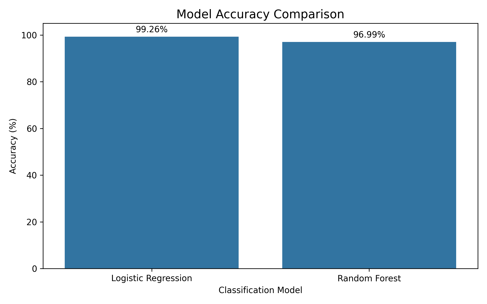
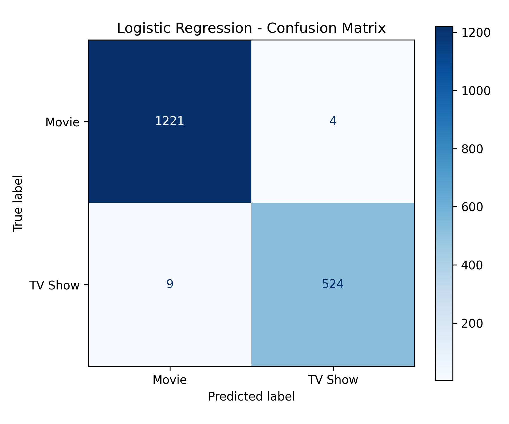
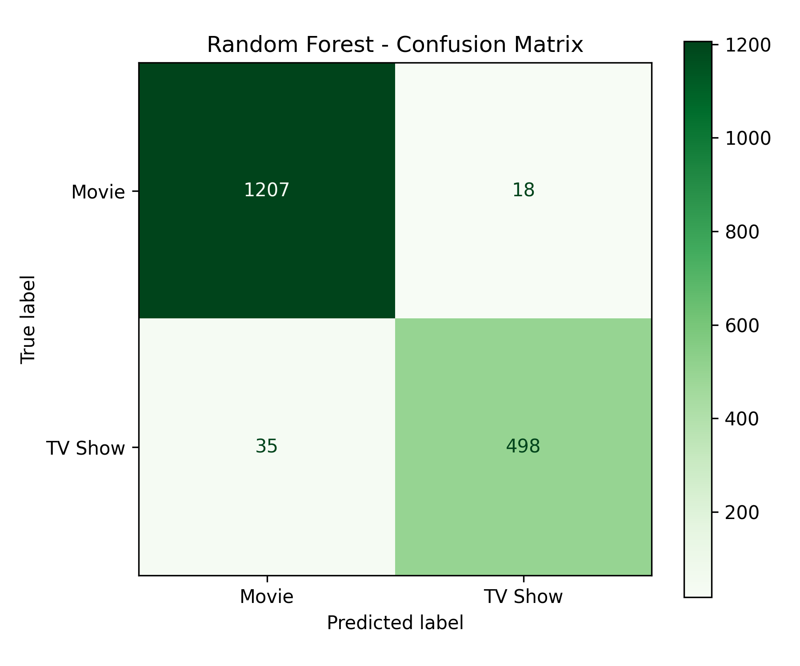
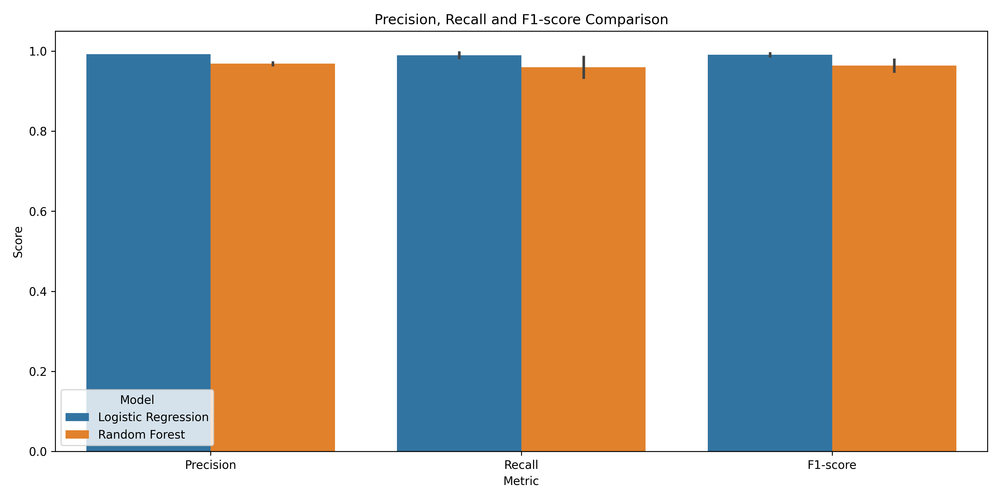
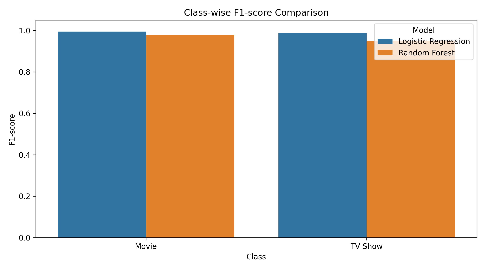

# Task 05 – Machine Learning Classification Model

## Project Overview

This project develops supervised machine learning classification models to predict whether a Netflix title is a **Movie** or a **TV Show** based on available dataset features.

Two classification algorithms are trained, evaluated, and compared using Scikit-learn.

## Objectives

- Select and prepare relevant features.
- Split data into training and testing datasets.
- Train classification algorithms.
- Evaluate model performance using multiple metrics.
- Compare model accuracy and classification performance.
- Visualize model evaluation results.

## Dataset

- **Dataset:** Netflix Movies and TV Shows
- **Total records:** 8,790
- **Source:** Cleaned dataset generated in Task 1.
- **Target variable:** `type`

## Features Used

### Numerical Features
- `release_year`
- `date_added_year`
- `date_added_month`

### Categorical Features
- `rating`
- `country`
- `listed_in`

The `duration` and `duration_unit` columns were excluded to avoid direct target leakage.

## Machine Learning Algorithms

1. **Logistic Regression**
2. **Random Forest Classifier**

## Data Preparation

- Train-test split: 80:20
- Random state: 42
- Stratified sampling
- Median imputation for numerical features
- Most-frequent imputation for categorical features
- One-Hot Encoding
- Standard Scaling
- Scikit-learn preprocessing pipelines

## Model Evaluation

| Model | Accuracy |
|---|---:|
| Logistic Regression | 99.26% |
| Random Forest | 96.99% |

Logistic Regression achieved the highest accuracy on the test dataset.

## Evaluation Metrics

The models were evaluated using:

- Accuracy
- Precision
- Recall
- F1-score
- Confusion Matrix

## Visualizations

The project includes the following evaluation visualizations:

### 1. Model Accuracy Comparison

### 2. Logistic Regression Confusion Matrix

### 3. Random Forest Confusion Matrix

### 4. Classification Metrics Comparison

### 5. Class-wise F1-score Comparison

## Key Findings

- Both models successfully classified Netflix content.
- Logistic Regression achieved 99.26% test accuracy.
- Random Forest achieved 96.99% test accuracy.
- Logistic Regression performed better on the selected test dataset.
- Confusion matrices and classification reports provide additional insight into class-wise prediction performance.

## Output Files

The `outputs` folder contains:

### Trained Models
- `logistic_regression_model.pkl`
- `random_forest_model.pkl`

### Evaluation Reports and Predictions
- `model_comparison.csv`
- `final_model_summary.csv`
- `prediction_results.csv`
- `logistic_regression_report.csv`
- `random_forest_report.csv`
- `logistic_confusion_matrix.csv`
- `random_forest_confusion_matrix.csv`

### Visualizations
- `model_accuracy_comparison.png`
- `logistic_confusion_matrix.png`
- `random_forest_confusion_matrix.png`
- `classification_metrics_comparison.png`
- `classwise_f1_comparison.png`

## Conclusion

This project demonstrates the application of supervised machine learning classification algorithms to Netflix content data.

Logistic Regression achieved the highest test accuracy among the two evaluated models. The project also demonstrates feature preprocessing, model training, performance evaluation, visualization, and model persistence.

Further validation on independent and newer data is recommended before using the model for real-world predictions.

## Limitations

- The evaluation uses a single stratified train-test split.
- Features such as `listed_in` and `country` may contain strong signals associated with content type.
- High test accuracy does not guarantee performance on future Netflix content.
- Further validation and feature importance analysis would help assess generalization.

## Skills Demonstrated

- Machine Learning
- Classification Algorithms
- Feature Selection
- Data Preprocessing
- Scikit-learn
- Pipeline Construction
- Model Training
- Model Evaluation
- Data Visualization
- Predictive Analytics
- Model Persistence